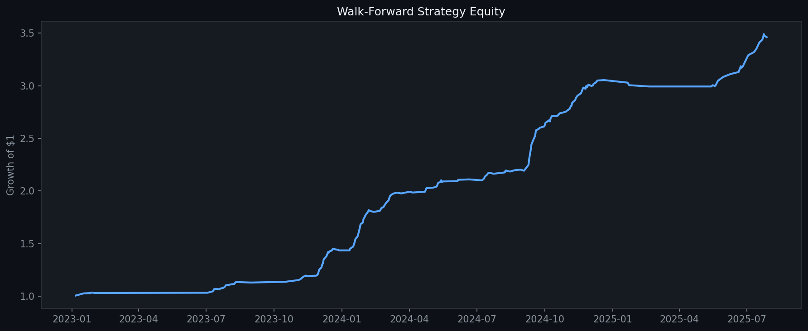

# Smart Market AI

A trading research system that tries to prove itself wrong before it trusts a model. It trains a machine-learning model on market data using walk-forward testing, runs a set of automated audits on the result, and only then lets a paper-trading bot act on its signals.

> Educational project. Not financial advice. It trades on an Alpaca **paper** account by default.



## The idea

Most backtests look good because the test quietly leaks information from the future. This project is built around not fooling itself:

- **Walk-forward testing.** The model is always tested on data that comes after what it trained on, never shuffled.
- **Automated audits** run after training, covering feature leakage, feature redundancy, feature drift, temporal stability, ticker dependency and a Monte Carlo shuffle test.
- **A trust gate.** Setups are graded (A/B/C), and the bot only takes the ones that pass the quality gate and the risk limits.
- **Stress tests.** Results are re-run with extra slippage to see whether the edge survives costs.
- **Honest caveats.** The Kronos forecast features come from a model whose training data probably overlaps the backtest window, so they are treated as signals, never as ground truth (see `kronos_provider.py`).

## What is in here

| File | What it does |
| --- | --- |
| `smart_market_ai_ml.py` | The core: data, feature engineering, walk-forward training, audits, backtests, signals |
| `quick_train.py` | One-command training with default settings |
| `trade_bot.py` | Auto-trading loop: retrain, open top setups, manage stops and targets, stop on session limits |
| `broker.py` | Alpaca adapter, so a different broker could be swapped in |
| `kronos_provider.py`, `model/` | Optional Kronos forecast features (vendored from [shiyu-coder/Kronos](https://github.com/shiyu-coder/Kronos), MIT licence) |
| `streamlit_app.py` | A Streamlit dashboard for signals, charts and the paper-trading journal |
| `bot_config.json` | Risk limits, position sizing, universe of tickers |
| `robustness_results.csv` | Output of a parameter robustness sweep |

## Setup

You need Python 3.10 or newer.

```bash
python -m venv .venv
.venv\Scripts\activate           # Windows
pip install -r requirements.txt
copy .env.example .env           # then add your own keys
```

You will need a free [Finnhub](https://finnhub.io) key and an [Alpaca](https://alpaca.markets) paper-trading account. The first run downloads market data and model weights, so it takes a while.

## Run

```bash
python quick_train.py                       # train with defaults
python quick_train.py --tickers NVDA,MSFT --period 3y --horizon 20
streamlit run streamlit_app.py              # dashboard at localhost:8501
python trade_bot.py --dry-run               # compute orders, never place them
python trade_bot.py                          # paper trading loop
```

On Windows you can also double-click `Train.bat`, `Dashboard.bat` and `Bot.bat` after creating the `.venv`.

## Safety

- Paper trading is the default. Real orders need **both** `"live": true` in `bot_config.json` **and** `ALPACA_LIVE=1` in `.env`. The config in this repo ships with `live` set to `false`.
- Dropping a file named `STOP_BOT` next to the bot flattens positions and exits. Ctrl+C does the same.
- Session profit target, session stop, an equity circuit breaker and per-position and sector caps are all set in `bot_config.json`.
- Keys live in `.env`, which is git-ignored.

## Limits

This is a learning project. Backtests, however carefully audited, are not proof of future returns, and the strategy has not been run with real money. The code is also large and due for splitting into modules and adding tests.

## Built with

Python, pandas, scikit-learn, PyTorch, yfinance, Streamlit, Plotly, Alpaca API, Finnhub.
